<div align="center">


# okAI-helper

**Language models on your Mac, private and local**<br>
Chat · Prompt profiles · Speech input · OpenAI-compatible server · Models bigger than memory · Models without network · Guard monitor

[](https://github.com/revil-O/okAI-helper-releases/releases/latest)


[](LICENSE)

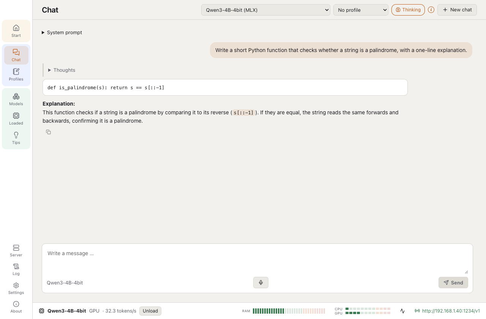

<sub>Qwen3-4B (MLX) on a Mac mini M4 with 16 GB: the thoughts folded, the answer as Markdown, 32 tokens per second.</sub>

[Download](https://github.com/revil-O/okAI-helper-releases/releases/latest) · [Changes](CHANGELOG.md) · [Measurements](docs/MEASUREMENTS.md) · [Benchmarks](docs/BENCHMARKS.md) · [Licence](LICENSE)

The app speaks **English** · Deutsch · Español · Português (Brasil) · Português (Portugal)

<sub>Made by the author of [VulKara](https://github.com/revil-O/VulKara), with the same look and feel. This repository holds the signed and notarized releases; the app looks here for its updates.</sub>

</div>

---

> [!TIP]
> ** Models bigger than your memory, from the SSD.** A mixture-of-experts model that does not fit into
> memory runs on the CPU and reads its weights from the drive while it answers, at full quality: Qwen3-30B-A3B
> (17 GiB) answers on a 16 GB Mac mini. With the expert cache the experts stream into fixed memory instead, 15–18
> tokens per second from a cold start. [Big models on small Macs](#big-models-on-small-macs)

> [!NOTE]
> ** No model can phone home.** Every engine runs in macOS's sandbox: the kernel blocks the
> internet, the local network and even name lookups for it, and the app proves the lock holds before the first model
> starts. Discord, VS Code and other programs still reach the models through the app's server.
> [Privacy and network](#privacy-and-network)

## Why okAI-helper

<table>
<tr>
<td width="33%" valign="top">

###  Everything on the Mac
Chats, prompts and answers stay on the Mac. The engines have no network at all; the app itself goes online only to
search and download models, to install its engines and to look for its own updates, each with a switch of its own.

</td>
<td width="33%" valign="top">

###  Your models, any folder
GGUF files and MLX folders on the internal SSD or an external drive, in the layout of Hugging Face and LM Studio (an
existing LM Studio folder works as it is). A browser for Hugging Face shows what each model can do and whether it
runs on this Mac before you download.

</td>
<td width="33%" valign="top">

###  Knows what fits
Every model gets a memory plan before it loads: on the GPU when it fits (llama.cpp or MLX), streamed from the SSD
when it is a mixture of experts bigger than memory, refused when it would freeze the Mac. A guard stops an engine
that holds more memory than planned.

</td>
</tr>
<tr>
<td valign="top">

###  For your other tools
An OpenAI-compatible server (`/v1/chat/completions`, `/v1/embeddings`, `/v1/audio/transcriptions` …) behind a token,
on this Mac or in your network, limited to the devices you allow. A request loads the model it names.

</td>
<td valign="top">

###  A guard monitor
CPU, GPU, memory, drive reads and tokens per second of every loaded model, live, next to what was measured for it on
this Mac, with the difference in colour.

</td>
<td valign="top">

###  Explained, in five languages
Every setting explains itself on hover; the Tips page explains them in detail with sources. English, German, Spanish
and Portuguese (Brazil and Portugal).

</td>
</tr>
</table>

## A tour

### Start
Engines, memory, the library and the server at a glance. The app installs its engines itself (llama.cpp, MLX, MLX
vision, Parakeet), at fixed versions checked by their checksums.

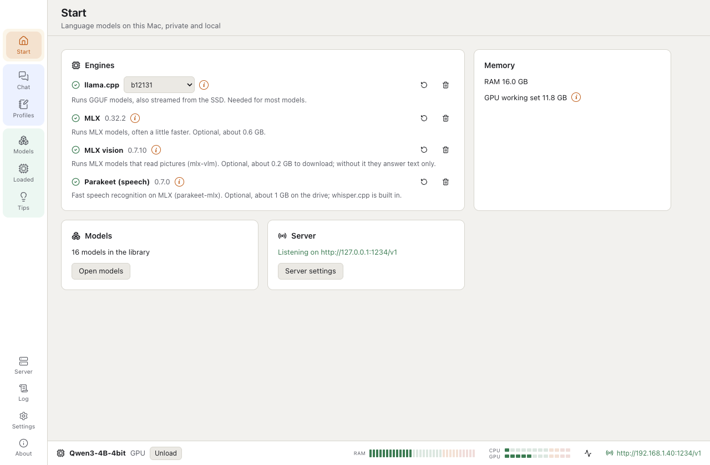

### Chat
Streaming answers as Markdown, a system prompt, the model's thoughts folded, a thinking switch for models that know it,
speech input. While a model works, a fixed line above the input says what it does, with the seconds and tokens so far.

<table>
<tr>
<td width="50%">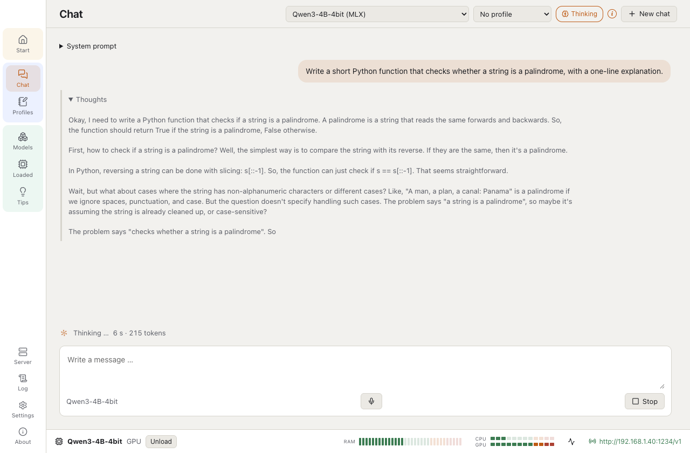</td>
<td width="50%">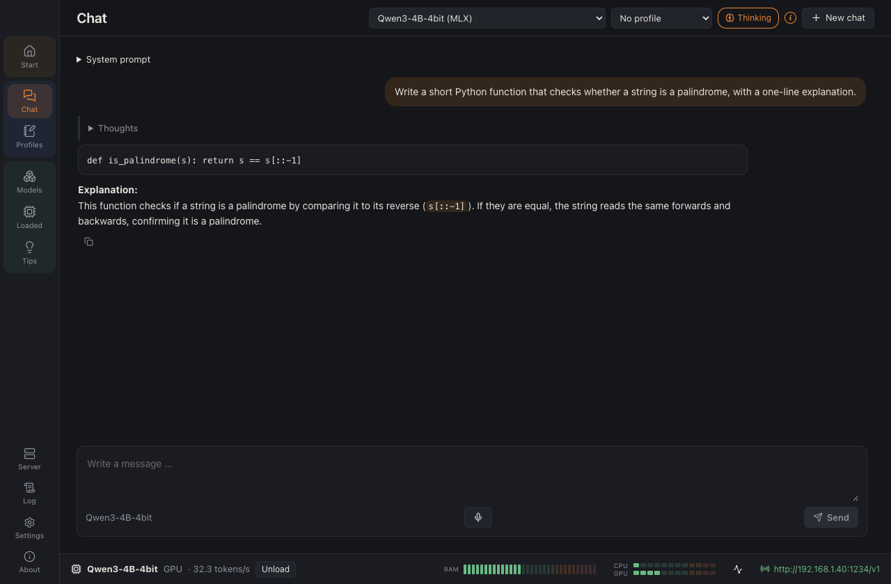</td>
</tr>
</table>

### Prompt profiles
A system prompt with choosable fields (Java version, database, shell …), example dialogs and sampling values for a
task, eleven templates. Chosen in the chat, and on the server as `model@profile`.

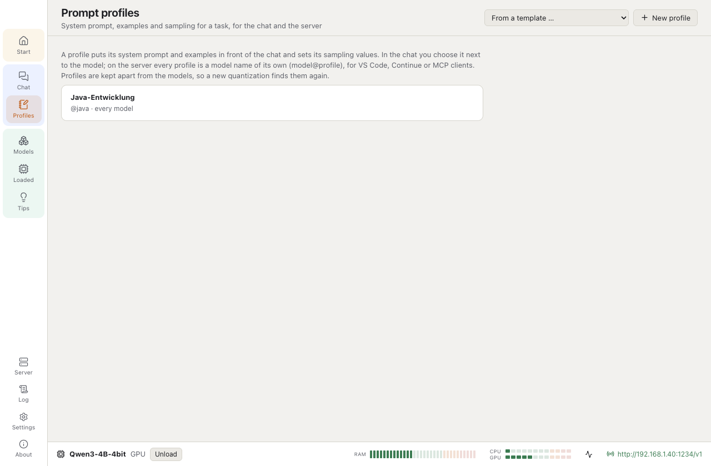

### Models and Hugging Face
The library as a table: architecture, parameters, format, quantization, size and where each model runs. The Hugging
Face search shows downloads, likes, licence, context and abilities; the details read the model's real shape from a few
MB of its header and say for every file whether it fits this Mac. Downloads resume and are checked by their SHA-256.

<table>
<tr>
<td width="50%">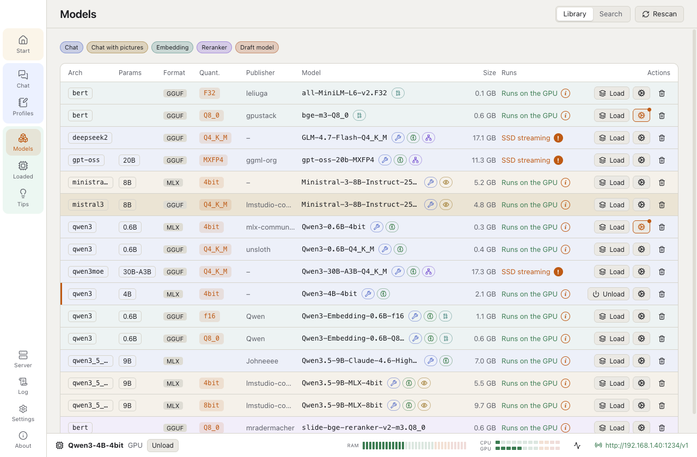</td>
<td width="50%">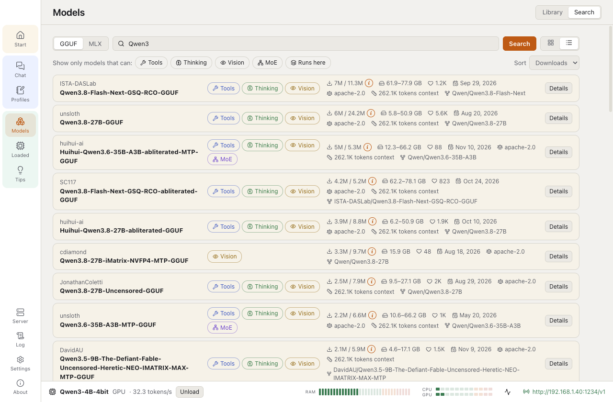</td>
</tr>
</table>

### Loaded and the guard monitor
The models in memory with their context and speed; the guard monitor in a window of its own (status bar, Loaded, the
app menu or the menu bar icon).

<table>
<tr>
<td width="50%">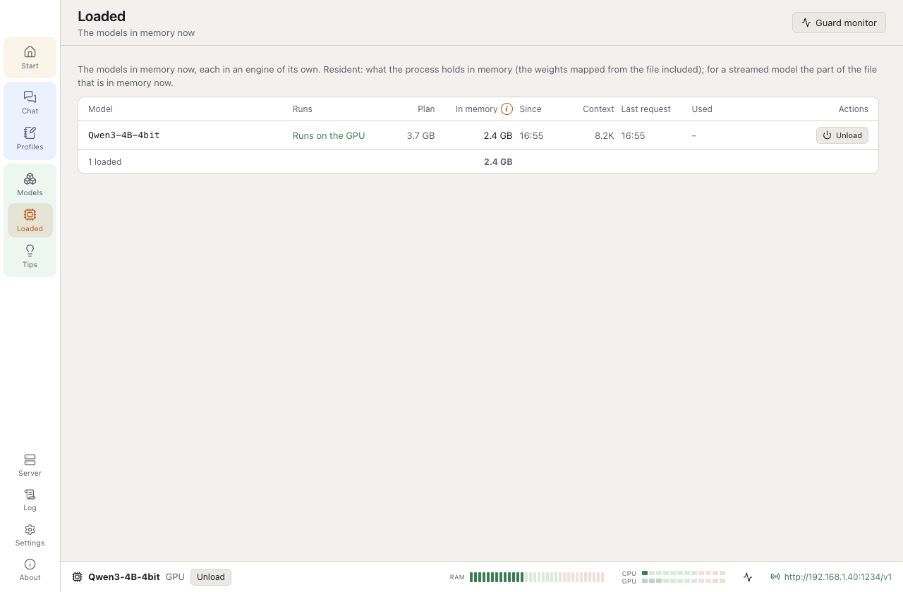</td>
<td width="50%">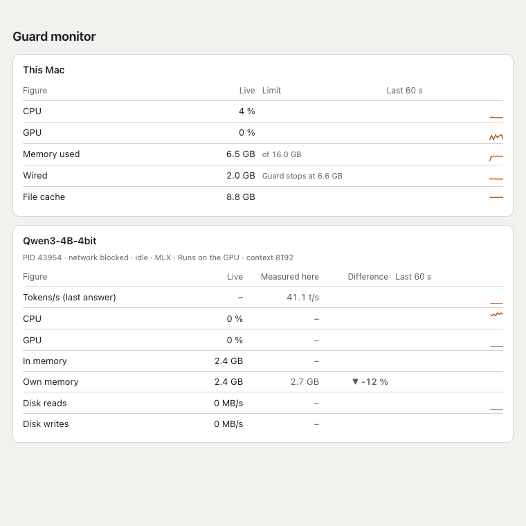</td>
</tr>
</table>

### Server and log
The server's address, the token, the allowed devices and the endpoints; the log of the last 100 requests with the
client, the model, the status, the key that came and the tokens.

<table>
<tr>
<td width="50%">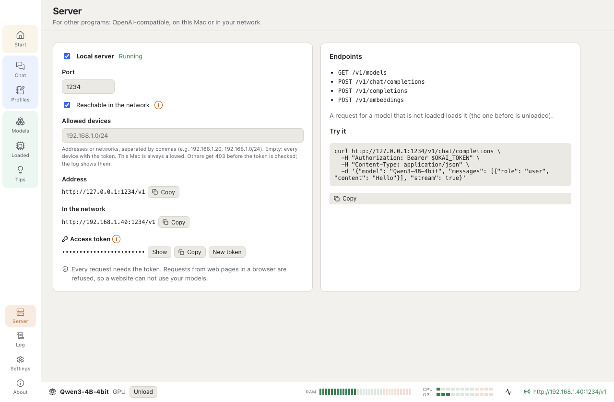</td>
<td width="50%">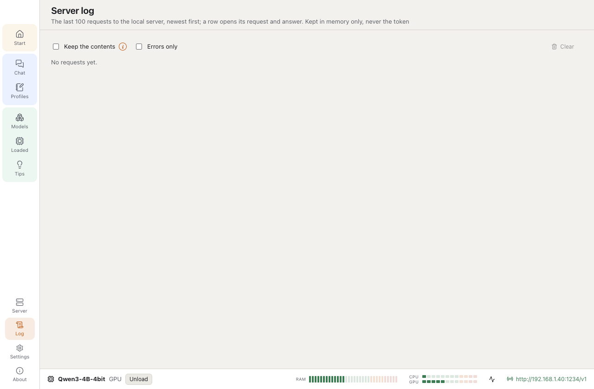</td>
</tr>
</table>

### Privacy and network, tips, about
The switches for the sandbox and the app's own traffic; tips with sources; the version, its updates and the changes.

<table>
<tr>
<td width="33%">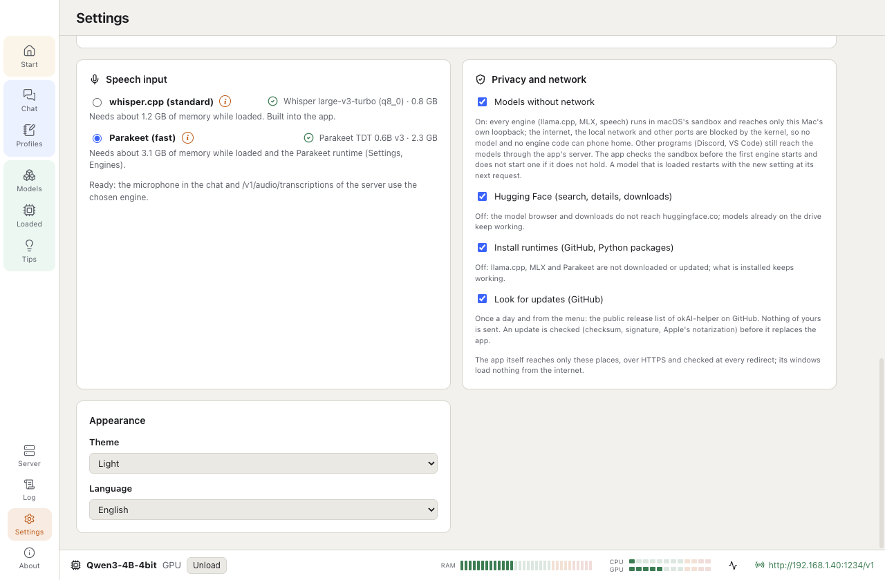</td>
<td width="33%">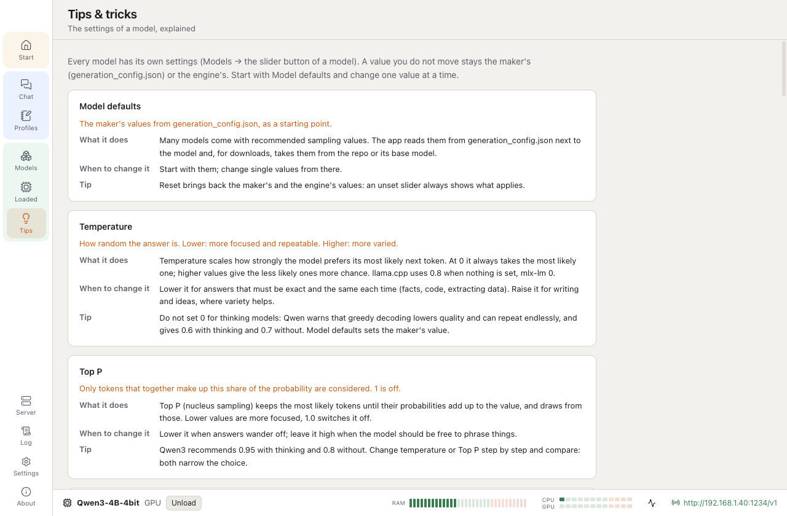</td>
<td width="33%">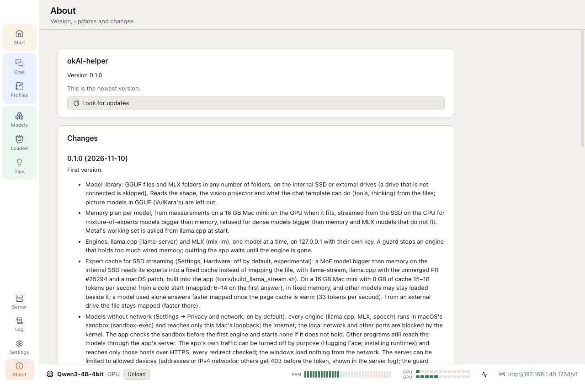</td>
</tr>
</table>

### Light or dark
As macOS, or chosen in the settings.

<table>
<tr>
<td width="50%">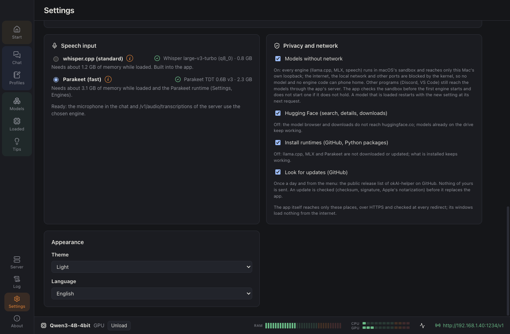</td>
<td width="50%">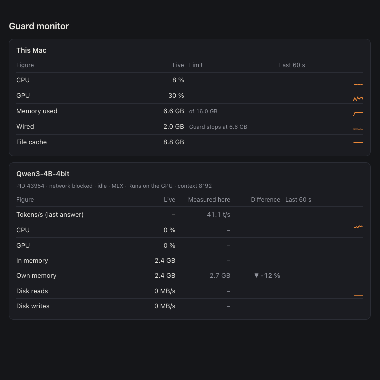</td>
</tr>
</table>

## Quick start

1. [Download the DMG](https://github.com/revil-O/okAI-helper-releases/releases/latest), open it and drag okAI-helper to
   Applications. It is signed with a Developer ID and notarized by Apple.
2. **Start → Engines:** install llama.cpp (and MLX for MLX models).
3. **Models → Search:** find a model that runs on this Mac, download it, then **Load** it and ask in the **Chat**.
4. Optional: **Server** on, copy the token, and use the models from other programs.

The app looks for a newer version once a day (Settings → Privacy and network), and updates itself after checking the
download's checksum, signature and notarization.

## Requirements

- A Mac with Apple Silicon and macOS 14 or newer. Tested on a Mac mini M4 with 16 GB and a MacBook Pro M2 with 24 GB.
- Nothing else: the app installs its engines itself (*Start → Engines*), at fixed, tested versions and checked by
  their checksums: llama.cpp b9660 or b12131, chosen in the settings (about 25 MB) and, optionally for MLX models, mlx-lm 0.32.2 with its own Python (and mlx-vlm 0.7.10 for MLX models that read pictures)
  (about 0.6 GB). Homebrew or the Mac's Python are not used; an own llama-server or Python can still be set under
  *Settings → Engines*.

On the first start macOS asks whether okAI-helper may access files on a removable volume when a model folder lies on
an external drive. Allow it, or the models there are not read.

## Big models on small Macs

Measured on a Mac mini M4 with 16 GB (charts in [docs/BENCHMARKS.md](docs/BENCHMARKS.md), details in [docs/MEASUREMENTS.md](docs/MEASUREMENTS.md)):

| Model | How it runs | Speed |
| --- | --- | --- |
| Ministral 3 8B, Q4_K_M (4.8 GB) | GPU, llama.cpp | 19.7 tokens/s |
| Ministral 3 8B, MLX 4 bit | GPU, MLX | 21.7 tokens/s |
| Qwen3 30B-A3B, Q4_K_M (17.3 GiB, MoE) | CPU, streamed from the external SSD (`--no-repack`) | 6.66 tokens/s |
| Qwen3 32B, Q4_K_M (18.4 GiB, dense) | refused | prompt 0.3 tokens/s, no answer within 20 minutes |

A model bigger than memory is never handed to the GPU: on a 16 GB Mac that wired all memory and froze the Mac. A guard
stops an engine that holds more wired memory than its plan allows.

## Privacy and network

No model and no engine code can phone home. Measured on a Mac mini M4 (macOS 26.6); more in the wiki page *Privacy and
network*.

**The engines (on by default, *Settings → Privacy and network → Models without network*).** llama.cpp, MLX, mlx-vlm,
Parakeet and whisper.cpp each run inside macOS's sandbox (Seatbelt, started with `sandbox-exec`, no administrator
rights needed). The kernel refuses every outgoing connection of the engine and of everything it starts: the internet,
the local network, other ports of this Mac (a local proxy could forward them) and name lookups (DNS through
mDNSResponder, a lookup alone can carry data out). The system services that would go on the network for it are closed
too: launch services (opening a link in the browser), background downloads (nsurlsessiond) and Apple events. Only the
engine's own port on `127.0.0.1` can be reached, by the app. The libraries of Hugging Face also get `HF_HUB_OFFLINE=1`
and `HF_HUB_DISABLE_TELEMETRY=1`, but those are requests; the sandbox is the lock.

Before the first engine of a session the app checks that the sandbox holds: curl reaches a small server of the app on
this Mac without the sandbox and must be refused inside it. If `sandbox-exec` is missing or the check fails, no engine
starts and the app says why; the switch turns the lock off (with a warning). A loaded model restarts with a changed
setting at its next request. The guard monitor shows "network blocked" or "network open" for each engine.

What was checked: from inside the sandbox HTTPS to huggingface.co, HTTP by IP address, the router, UDP to port 53,
another port of this Mac, a name lookup and `lsappinfo` all failed; llama-server with Metal, mlx-lm, Parakeet and
whisper-server loaded and answered unchanged, and macOS reported each engine process as denied network-outbound
(`sandbox_check`).

**The app itself (*Settings → Privacy and network*).** It goes on the internet for two purposes only, each with a
switch: *Hugging Face* (search, details, downloads; huggingface.co and its storage) and *Install runtimes* (llama.cpp
from GitHub; uv then fetches Python and the packages from PyPI, at pinned versions with checksums). Requests go over
HTTPS to those hosts only, and every redirect is checked; with a switch off the request is refused before it starts.
The app's windows load nothing from the network.

**Other programs (*Server*).** Discord bots, VS Code or Paperless reach the models through the app's server; it is not
in the sandbox. It listens on this Mac only until *Reachable in the network* is on, always wants the access token and
refuses requests from web pages. *Allowed devices* (addresses or IPv4 networks, e.g. `192.168.1.0/24`) limits who may
use it from the network; others get 403 before the token is checked, and the server log shows their address.

**Limits.** `sandbox-exec` is marked deprecated by Apple (its manual points to the App Sandbox) but works on current
macOS; if Apple removes it, the check above stops the engines instead of running them unlocked. uv's hosts are not
limited one by one, only switched on or off. What a client does with an answer (a bot running tools) is outside the
app. llama-stream, the engine for MoE models streamed into a fixed cache (off by default), is built from llama.cpp's
unmerged pull request #25294 with a patch of its own; its request parser has not been reviewed beyond that. It runs
only with the expert cache turned on, in the same sandbox, on `127.0.0.1` and with its own key.

## Guard monitor

Open it from the status bar, *Models → Loaded*, the app menu or the menu bar icon. It polls once a second only while it
is open (about 2 % of one core on a Mac mini M4) and stops when it closes.

- **This Mac:** CPU, GPU, memory used of the total, wired memory against the limit at which the guard stops an engine,
  and the file cache, each with the last 60 seconds as a line.
- **Per model:** process id, network state, idle or answering, engine, where it runs and its context; then tokens per
  second of the last answer, CPU, GPU, memory (resident, and its own memory without the mapped file), drive reads and
  writes per process, each *live · measured here · difference*.
- **The difference** is only shown for a model measured on this kind of Mac (chip and memory), from
  [docs/MEASUREMENTS.md](docs/MEASUREMENTS.md): within ±20 % neutral (single runs vary that much), 20–40 % worse in
  amber, more than 40 % in red, better in green, with ▲/▼. CPU and GPU are compared only while the model answers; two
  models answering on the GPU at once show "GPU shared" instead (the GPU's time is not split reliably between them).
  An MLX model compares its own memory, because MLX keeps the weights in Metal buffers outside the resident pages.
- **Disk reads** count reads from the file cache too: a model read again from memory shows high rates while the drive
  itself is idle.

CPU and drive figures per process come from `proc_pid_rusage` (the small helper `okai-probe`), GPU time per process from
the Metal clients in `ioreg`; neither needs administrator rights. The GPU keys are not documented by Apple: if they
change, the GPU column shows "–" and the rest keeps working.

## Using the server

Turn it on under **Server**, copy the token, then (the port is shown there, 1235 by default):

```bash
curl http://127.0.0.1:1235/v1/chat/completions \
  -H "Authorization: Bearer $OKAI_TOKEN" -H "Content-Type: application/json" \
  -d '{"model": "MODEL-ID", "messages": [{"role": "user", "content": "Hello"}], "stream": true}'
```

Model ids are listed by `GET /v1/models` and shown on the Models page.

## Licence

[PolyForm Noncommercial 1.0.0](LICENSE). Free for non-commercial use.
