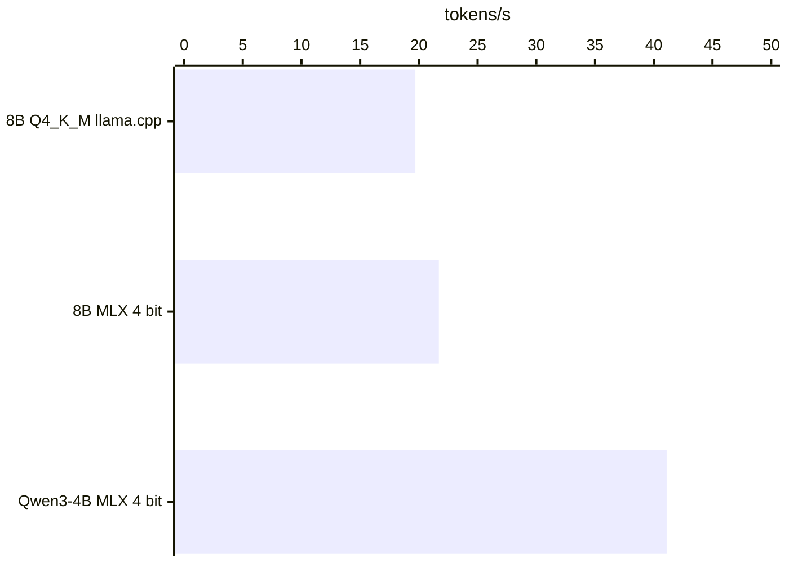
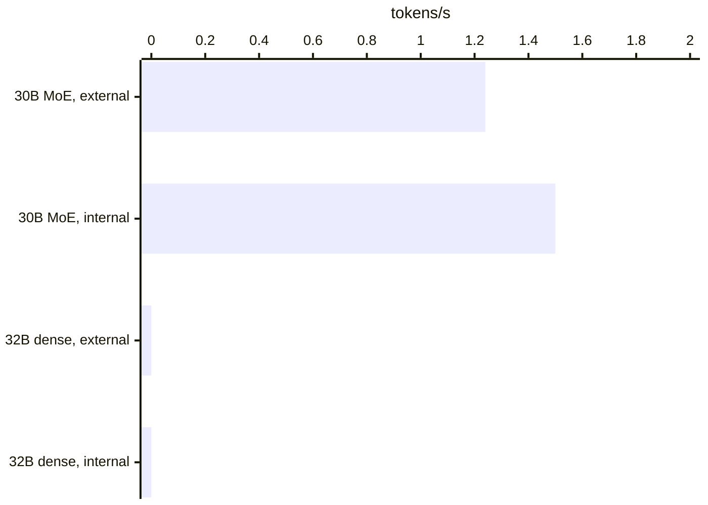
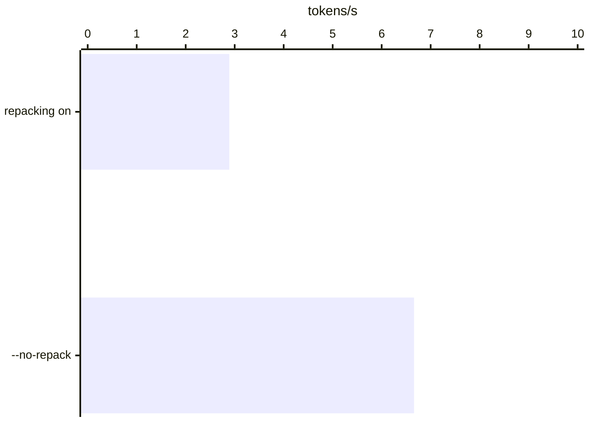
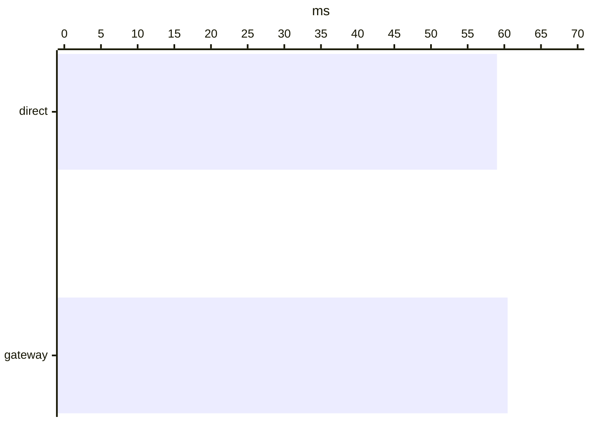
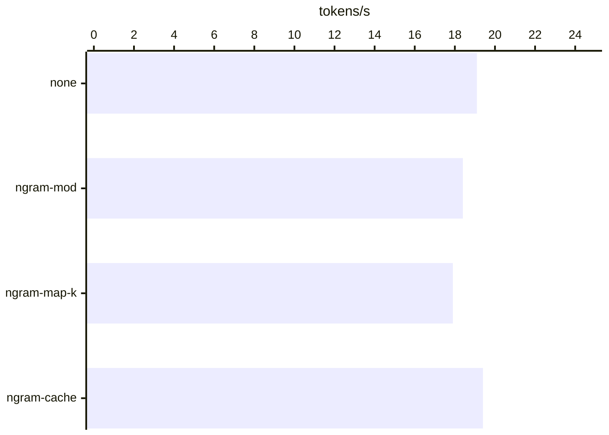

# Benchmarks

[README](../README.md) · [Measurements](MEASUREMENTS.md)

Measured on the Mac mini M4, 16 GB, the target machine. Every figure is in [MEASUREMENTS.md](MEASUREMENTS.md) with how it was taken.

Written by tools/build_benchmarks.mjs from tools/benchmarks_data.mjs; edit the figures there.

| | |
| ---: | --- |
| **21.7 tokens/s** | Ministral 3 8B on MLX, 4 bit ([measurement](MEASUREMENTS.md#spike-2026-11-05-models-that-fit-into-memory)) |
| **6.66 tokens/s** | Qwen3-30B-A3B (18.5 GB) streamed from the external SSD on a 16 GB Mac ([measurement](MEASUREMENTS.md#streaming-a-model-bigger-than-memory-llamacpps-weight-repacking-2026-11-06)) |
| **+1.5 ms** | the gateway to the first token ([measurement](MEASUREMENTS.md#spike-2026-11-05-gateway-overhead)) |
| **0.97 GB/s** | read from the external USB SSD ([measurement](MEASUREMENTS.md#spike-2026-11-05-external-ssd)) |

## Models that fit into memory: answer speed

Generation of 128 tokens after a prompt of 512, three runs. The two Ministral files are quantized differently, so the engines compare only roughly.

| Model | Engine | Prompt t/s | Generation t/s |
| --- | --- | ---: | ---: |
| Ministral 3 8B, Q4_K_M | llama.cpp, Metal | 211.9 | 19.7 |
| Ministral 3 8B, MLX 4 bit | mlx-lm | 220 | 21.7 |
| Qwen3-4B, MLX 4 bit | mlx-lm | 434.2 | 41.1 |

Source: [MEASUREMENTS.md, Spike 2026-11-05: models that fit into memory](MEASUREMENTS.md#spike-2026-11-05-models-that-fit-into-memory)

## Bigger than memory: streamed from the SSD on the CPU

The first spike: llama-bench, prompt 32, 8 tokens generated, CPU only (never Metal: a model bigger than memory on the GPU wired all memory and froze the Mac), with llama.cpp's weight repacking still on (see the next chart). A dense model gave no token within 20 minutes.

| Model | Disk | Prompt t/s | Generation t/s |
| --- | --- | ---: | ---: |
| Qwen3-30B-A3B Q4_K_M, MoE | external SSD | 3.02 | 1.24 |
| Qwen3-30B-A3B Q4_K_M, MoE | internal SSD (partly cached) | 3.12 | 1.5 |
| Qwen3-32B Q4_K_M, dense | external SSD | 0.32 | – |
| Qwen3-32B Q4_K_M, dense | internal SSD (partly cached) | 0.28 | – |

Source: [MEASUREMENTS.md, Spike 2026-11-05: models bigger than memory (mmap streaming)](MEASUREMENTS.md#spike-2026-11-05-models-bigger-than-memory-mmap-streaming)

## Streamed from the SSD: without weight repacking

llama.cpp copies the weights into memory of its own by default; for a model bigger than memory macOS then swaps them to the internal SSD (writing about 210 MB/s) and never reads the model's drive. Without repacking the weights stay mapped and are read from their own drive.

| Setting | Tokens/s | Load s | Swap written MB/s | File read MB/s |
| --- | ---: | ---: | ---: | ---: |
| repacking on (llama.cpp default) | 2.89 | 109 | 213 | 0 |
| --no-repack (okAI-helper) | 6.66 | 30 | 0 | 205 |

Source: [MEASUREMENTS.md, Streaming a model bigger than memory: llama.cpp's weight repacking, 2026-11-06](MEASUREMENTS.md#streaming-a-model-bigger-than-memory-llamacpps-weight-repacking-2026-11-06)

## The gateway: time to the first token

Ministral 3 8B Q4_K_M, 128 tokens, temperature 0, five runs in each of two rounds. Throughput stays the same (19.35 / 19.3 tokens/s).

| Path | First token ms | Tokens/s |
| --- | ---: | ---: |
| direct to llama-server | 59 | 19.35 |
| through the gateway | 60.45 | 19.3 |

Source: [MEASUREMENTS.md, Spike 2026-11-05: gateway overhead](MEASUREMENTS.md#spike-2026-11-05-gateway-overhead)

## Speculative decoding with n-grams: all six tasks

Ministral 3 8B Q4_K_M, llama.cpp b12131, temperature 0, six different tasks once per mode. Not built in: no reliable gain, and ngram-cache gave other answers in four of six tasks.

| Task | none | ngram-mod | ngram-map-k | ngram-cache |
| --- | ---: | ---: | ---: | ---: |
| Java refactor | 18 | 18 = | 17.4 = | 21.9 ≠ |
| Python, new | 19.2 | 18.4 = | 18 = | 18.3 ≠ |
| SQL change | 19.4 | 18.7 = | 18 = | 24.8 = |
| JSON extract | 19.3 | 18.6 = | 18 = | 18.5 = |
| Summary (German) | 19.4 | 19.1 = | 18 = | 21.1 ≠ |
| Free text (German) | 19.3 | 18.3 = | 18 = | 18 ≠ |

= the same answer as without, ≠ another answer.

Source: [MEASUREMENTS.md, Speculative decoding without a draft model (n-gram), 2026-11-05](MEASUREMENTS.md#speculative-decoding-without-a-draft-model-n-gram-2026-11-05)
